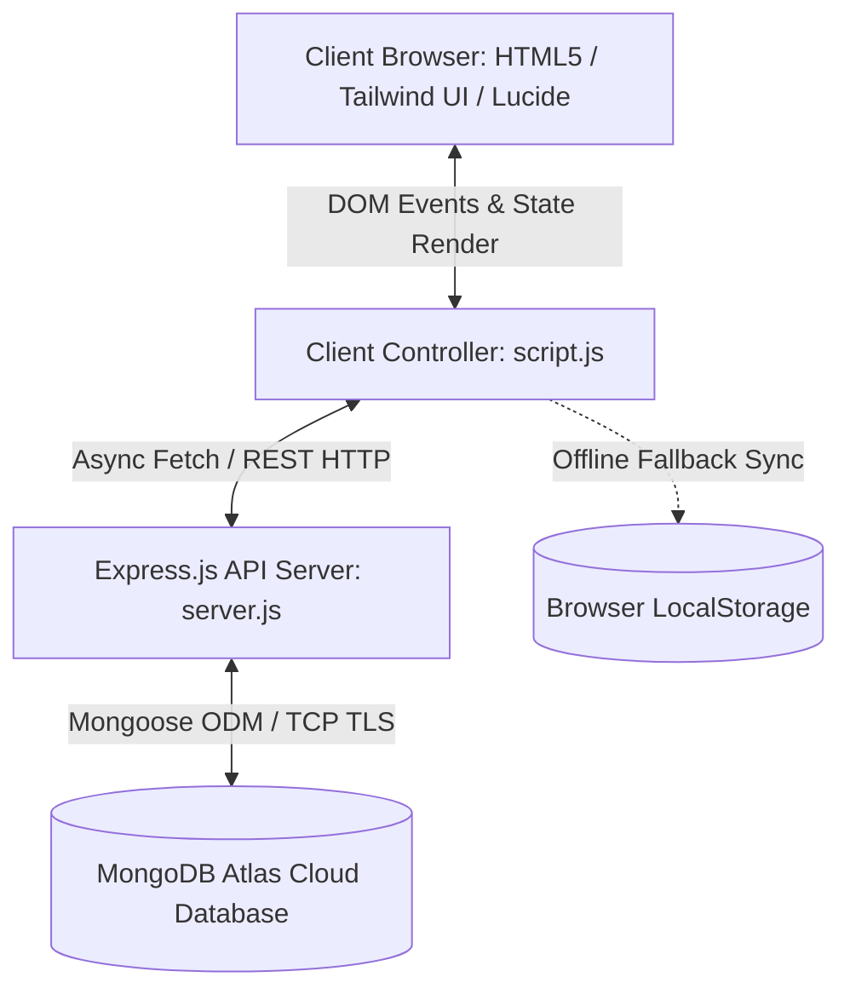

# Project Architecture & Defense Report: Apex Horizon National Bank

---

## 1. High-Level Executive Summary
**Project Name:** Apex Horizon National Bank — Retail Banking Simulator  
**Architecture:** 3-Tier Client-Server Full-Stack Web Application  
**Tech Stack:**
- **Presentation Layer (Frontend UI):** Semantic HTML5, Vanilla CSS, Tailwind CSS (Utility Framework), Lucide Icons.
- **Application & Client Controller Layer:** Vanilla JavaScript (ES6+), Event-Driven View Controller, Async REST API client.
- **Backend & Middleware Layer:** Node.js runtime, Express.js REST API server, CORS & JSON body parsing middleware.
- **Persistence & Database Layer:** MongoDB Atlas (Cloud NoSQL DB) via Mongoose ODM, with an offline-first **Resilient Fallback Engine** (`localStorage`).

---

## 2. Layer-by-Layer Code & Architecture Breakdown



### Layer 1: Presentation & User Interface (`index.html` & `style.css`)
* **Core Function:** Delivers an institutional, modern banking portal with accessibility and visual hierarchy.
* **Component Partitioning:**
  1. **Authentication Gateway (`#view-login`):** Dual-entry login switcher between **Customer Portal** and **Bank Officer (Admin) Portal**, password masking toggle, and FDIC / TLS 256-bit security tickers.
  2. **App Shell (`#view-app-portal`):**
     - **Dynamic Top Navigation:** Real-time active session countdown timer (auto-logout at 5:00 idle), user initials avatar, and dynamic role indicators.
     - **Contextual Sidebar:** Toggles customer navigation tabs (Overview, Transfer, History, Services) vs. administrative controls (System Liquidity, Patron Registry, Approval Queue).
  3. **Customer Tabs:**
     - `tab-overview`: Visual account cards (Checking with live balance, High-Yield Savings with 4.85% APY yield counter, Combined Net Liquidity).
     - `tab-transfer`: ACH / Fedwire fund transfer form with 9-digit ABA routing validation, beneficiary selector, and overdraft protection logic.
     - `tab-history`: Real-time transaction ledger with multi-parameter filtering (Search, Account type, Debit/Credit) and instant CSV statement download.
     - `tab-services`: Applications for credit cards (tier selection, income declaration) and chequebooks (leaf count, address confirmation).
  4. **Admin Supervisory Tabs:**
     - `tab-admin-overview`: Real-time aggregate metric counters (Total Liquidity, Registered Patrons, Global Audited Flow).
     - `tab-admin-users`: Patron table with masked account references (`•••• •••• 4891`) and "Register New Patron" modal.
     - `tab-admin-requests`: Dedicated compliance queue to inspect, approve, or reject customer filings.

---

### Layer 2: Client Logic & State Controller (`script.js`)
* **Core Function:** Manages client-side routing, input validation, transaction math, and UI updates without page reloads (Single-Page Application behavior).
* **Key Mechanisms:**
  1. **Hybrid Synchronization Engine:**
     ```javascript
     // Loads from MongoDB via Express; falls back safely to LocalStorage if offline
     async function initDatabase() { ... }
     function saveDatabase() { ... }
     ```
  2. **Balance & Ledger Invariants:**
     - Deducts source balance (`checkingBalance` or `savingsBalance`).
     - Generates audit transaction object (`TXN-XXXXXX`) with timestamp and `balanceAfter`.
     - Detects internal transfers: If the destination account belongs to another registered user in the database, it automatically credits their balance and logs a corresponding credit entry.
  3. **Supervisory State Updates:**
     - When an Admin approves a credit card or chequebook, the status updates across the database in real-time, instantly reflecting on the customer's portal.
  4. **Session Lifecycle:**
     - Simulates institutional timeout rules with a 5-minute countdown interval (`startSessionCountdown()`), automatically logging out inactive users.

---

### Layer 3: Backend REST API Server (`server.js`)
* **Core Function:** Centralized API server built on Express.js handling data persistence, validation, and serving frontend static files.
* **Key Endpoints:**
  | Method | Endpoint | Description |
  | :--- | :--- | :--- |
  | `GET` | `/api/health` | Health check returning server status and MongoDB connection state (`connected` / `disconnected`). |
  | `GET` | `/api/data` | Retrieves the full banking snapshot (users, transactions, service requests). |
  | `POST` | `/api/data/sync` | Atomically upserts modified entities into MongoDB collections using Mongoose. |
  | `POST` | `/api/data/reset` | Purges test data and reseeds initial demo patron accounts. |
* **Auto-Seed Guarantee:** On server startup, `seedDatabaseIfEmpty()` checks if the database is brand new; if zero users exist, it seeds Jane Sterling, Alex Reynolds, and Officer Morgan Vance automatically.

---

### Layer 4: Database & Data Modeling (`models.js` & MongoDB Atlas)
* **Core Function:** Cloud-hosted, schematized NoSQL storage with Mongoose ODM models:
  1. **`User` Schema:**
     - Holds primary credentials, contact details, account numbers, and dual balances (`checkingBalance`, `savingsBalance`).
     - Role-Based Access Control (RBAC): `role: { type: String, enum: ['customer', 'admin'] }`.
  2. **`Transaction` Schema:**
     - Immutable ledger entries containing `userId`, `accountType`, `type` (`credit`/`debit`), `amount`, `balanceAfter`, and ISO timestamps.
  3. **`ServiceRequest` Schema:**
     - Compliance applications containing applicant details, product specifications, and status (`pending`, `approved`, `rejected`).

---

## 3. How to Present to Your Teacher (Flawless Flow)

### Step 1: The 30-Second Elevator Pitch
> *"Good morning/afternoon, Teacher. Our project is Apex Horizon National Bank, an institutional full-stack retail banking simulator. It demonstrates modern financial software design: role-based customer and administrative workflows, real-time double-entry transaction ledgers, service request approval pipelines, and a 3-tier architecture backed by Node.js, Express, and MongoDB Atlas with offline-first client resilience."*

### Step 2: Live Demonstration Steps
1. **Login as Customer (`jane` / `1234`):**
   - Point out the active 5-minute security session timer at the top.
   - Show Checking balance ($14,250.75) and Savings balance ($48,900.20).
2. **Execute a Fund Transfer:**
   - Transfer $500 from Checking to Alex Reynolds (`1009182341`).
   - Show immediate debit in Jane's ledger and new calculated balance ($13,750.75).
   - Point out that data is synced asynchronously to the MongoDB backend.
3. **Submit a Credit Card Application:**
   - Navigate to **Services**, apply for the *Apex Executive Corporate* card, and submit.
   - Show the application status badge: `Pending Review`.
4. **Login as Admin (`admin` / `admin`):**
   - Show the supervisory dashboard displaying bank-wide liquidity and active patron counts.
   - Navigate to the **Approval Queue**: Jane's application appears.
   - Click **Approve**.
5. **Switch Back to Jane:**
   - Demonstrate that Jane's application status is now live and updated to `Approved & Dispatched`.

---

## 4. Comprehensive Viva Cross-Questions & Model Answers

### Q1: "Why did you choose MongoDB over a Relational Database like MySQL/PostgreSQL?"
> **Model Answer:**  
> *"MongoDB offers flexible document structures that map naturally to JSON-centric REST APIs and JavaScript runtimes without impedance mismatch. In a banking prototype, user entities contain nested account structures, diverse transaction metadata, and varying service request details. Furthermore, MongoDB Atlas provides zero-configuration cloud hosting, automatic failover, and rapid scaling."*

### Q2: "In real banking, balances cannot simply be edited in a database. How does your system handle ledger integrity?"
> **Model Answer:**  
> *"In our project, we follow an audit-trail approach. Every time a transfer occurs, the system doesn't just alter a number; it creates a dedicated `Transaction` record with an immutable ID, timestamp, transaction type (`debit`/`credit`), description, and `balanceAfter`. For peer transfers, counterpart transactions are logged for both the sender and the recipient, guaranteeing that debits match credits across accounts."*

### Q3: "What happens if the internet connection or MongoDB server goes down?"
> **Model Answer:**  
> *"We implemented a **Resilient Offline-First Hybrid Strategy** in `script.js`. When the client application initializes, it reads from `localStorage` immediately so the UI is instantaneous. It then queries `/api/data`. If MongoDB is online, it hydrates the state with cloud data. If the server is unreachable or offline, a `try/catch` block safely falls back to local storage, ensuring the customer never faces a blank or broken application."*

### Q4: "How is Role-Based Access Control (RBAC) enforced?"
> **Model Answer:**  
> *"The user model maintains a strict `role` property (`'customer'` or `'admin'`). During authentication, the client controller inspects `currentUser.role`. Customers are restricted to their personal ledger and personal transfer endpoints. Bank administrators are routed to supervisory management screens with systemwide vault liquidity metrics, customer account inspections, and compliance approval queues."*

### Q5: "How are passwords stored, and how would you enhance security in production?"
> **Model Answer:**  
> *"In this academic demonstration, passwords are stored directly for transparent evaluation. However, for a production rollout, we would:*
> 1. *Hash passwords using `bcrypt` with salt rounds.*
> 2. *Issue cryptographically signed JSON Web Tokens (JWT) stored in `HttpOnly` Secure cookies.*
> 3. *Enforce HTTPS/TLS encryption and strict CORS origins.*
> 4. *Implement rate limiting to prevent brute-force login attempts."*

### Q6: "Why do you have `cors` and `dotenv` in your Node.js backend?"
> **Model Answer:**  
> *"`dotenv` loads sensitive configuration—such as the database connection string (`MONGODB_URI`) and port—from the `.env` file into `process.env`, keeping credentials out of public source control. `cors` (Cross-Origin Resource Sharing) middleware ensures secure cross-origin communication between the frontend client and backend API when hosted on differing origins or ports."*

### Q7: "How is the Statement Export implemented?"
> **Model Answer:**  
> *"In `script.js`, the statement exporter compiles filtered ledger rows into standard RFC-4180 CSV format (Date, Transaction ID, Account, Description, Type, Amount, Running Balance). It converts the string into a client-side `Blob` with MIME type `text/csv`, creates an ephemeral `<a>` anchor with `URL.createObjectURL()`, and triggers an immediate browser download without requiring server-side file generation."*
